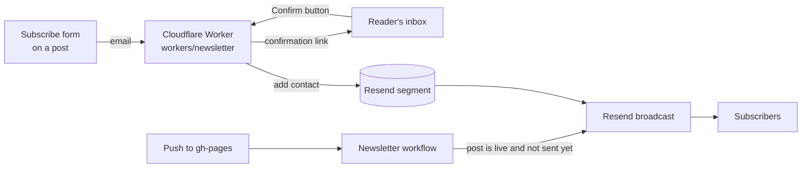

# Rajat Gupta Portfolio

Personal portfolio and writing site built with Jekyll and GitHub Pages. The site combines long-form posts, project case studies, career history, and a downloadable CV behind a lightweight custom presentation layer on top of the GitHub Pages-compatible `minima` theme.

## About The Project

This repository powers `https://rajatgupta.work` and contains:

- A homepage and static pages for about, experience, contact, posts, projects, and CV
- Blog content under `_posts/`
- Project case studies under `_projects/`
- A custom layout and stylesheet layer in `_layouts/`, `_includes/`, and `assets/main.css`
- GitHub Pages-compatible Jekyll configuration in `_config.yml`

The design is editorial and minimal: one reading column, warm paper and ink colours with a single accent, light and dark themes that follow the reader's system setting, and no cards, shadows or animation. The brief behind it, the rules it follows and the measurements that back it are in [ADR-004](docs/adr/adr-004-editorial-redesign.md).

Code blocks use a Molokai-inspired syntax highlighting palette implemented locally in `assets/main.css`.

Headings and the site title use Perfectly Nineties and body text uses Figtree, both self-hosted from `assets/fonts/`. See [Fonts](#fonts).

## Architecture

The site is structured as a standard Jekyll app:

- `_config.yml`: Site metadata, navigation, collections, plugins, and GitHub Pages-compatible settings
- `_layouts/`: Shared HTML layouts for pages, posts, and projects
- `_includes/`: Reusable fragments: header, footer, `figure.html` (post images), `toc.html` (contents list for long posts), `reading-time.html`, `topics.html`, `subscribe.html` (email sign-up form) and `comments.html` (giscus comments)
- `_data/topics.yml`: Display labels for post categories
- `_posts/`: Blog posts named with the `YYYY-MM-DD-title.md` convention
- `_projects/`: Project collection items rendered as standalone pages
- `assets/`: CSS, font, PDF, and image assets
- `docs/adr/`: Architecture Decision Records for notable project decisions (not published on the site)
- `_latex/`: LaTeX source for the downloadable CV in `assets/cv.pdf`
- `.github/workflows/site-checks.yml`: CI that builds the site, checks links, metadata and accessibility, and tests the newsletter code
- `.github/workflows/newsletter.yml`: Emails each new post to subscribers once it is live
- `.github/scripts/`: The axe-core accessibility scan, the source for the social preview image and favicons, and `newsletter.rb` with its email template and tests
- `subscribe/`: The subscribe page and the pages readers land on after signing up
- `workers/newsletter/`: Cloudflare Worker that handles sign-ups (not published on the site)
- `giscus.json`: Which sites may load this repository's discussions as comments

Rendering flow:

1. Markdown content is converted by Jekyll with `kramdown`
2. Rouge generates syntax highlighting markup for fenced code blocks
3. Layouts and includes assemble the final pages
4. `jekyll-redirect-from` writes a redirect page for every old URL listed in a post's `redirect_from`
5. `jekyll-seo-tag` adds the page title, description, canonical URL, Open Graph, Twitter card and JSON-LD; `jekyll-sitemap` writes `sitemap.xml` and `robots.txt`
6. `assets/main.css` applies the site design, including the fonts, the light and dark palettes and the Molokai code block theme

`AGENTS.md`, `README.md`, `docs/`, `giscus.json` and `workers/` are listed under `exclude:` in `_config.yml` so they are not published as pages.

## Install

Prerequisites:

- Ruby and Bundler installed locally

Install dependencies:

```bash
bundle install
```

## Develop Locally

Start the local Jekyll server with live reload:

```bash
bundle exec jekyll serve --livereload
```

Open `http://localhost:4000`.

## Run And Test

Use these commands during development and before opening a PR:

```bash
bundle exec jekyll doctor
bundle exec jekyll build --trace
JEKYLL_ENV=production bundle exec jekyll build
```

Check the built site the same way CI does. Node.js 22 is needed for the accessibility scan:

```bash
LC_ALL=C.UTF-8 bundle exec htmlproofer ./_site --disable-external --checks Links,Images,Scripts,OpenGraph,Favicon

cd .github/scripts && npm ci && npx playwright install chromium && cd ../..
python3 -m http.server 4000 -d _site &
node .github/scripts/axe-scan.mjs _site http://localhost:4000
```

The axe scan covers WCAG 2.2 AA plus best practices on every page, once in the light colour scheme and once in the dark one, and fails on serious or critical violations. Redirect pages are skipped. Text needs a contrast of at least 4.5:1 against its background in both themes.

Test the newsletter code:

```bash
JEKYLL_ENV=production bundle exec ruby .github/scripts/test/newsletter_test.rb
cd workers/newsletter && npm test && cd ../..
```

For content scheduled in the future or drafts:

```bash
bundle exec jekyll serve --drafts --future --livereload
```

Validation expectations:

- The site builds without Liquid or configuration errors
- Pages render correctly in the generated `_site/` output
- Code blocks render with the expected Molokai styling
- Pages read well at 390px and 1440px wide, in light and dark mode: body text 18px on phones and 19px on laptops, 60 to 75 characters per line on a laptop, no sideways scrolling
- `html-proofer` and the axe scan pass
- Visual regressions are checked manually for layout changes

## Search, Sharing And Analytics

- Page titles, descriptions, canonical URLs, Open Graph and Twitter card tags come from `jekyll-seo-tag`. Site-wide values (`tagline`, `description`, `author`, `twitter`, `social`) live in `_config.yml`; a page overrides them with its own `title`, `description` or `image`.
- Every page falls back to `assets/img/social-card.png` as its preview image. To change the card or the favicons, edit `.github/scripts/social-card.html` and run `npm run social-card` in `.github/scripts/`.
- The homepage carries `ProfilePage` structured data (`_includes/profile-jsonld.html`), filled from `profile:` in `_config.yml`. Validate it with Google's Rich Results Test after changes.
- To verify the site in Google Search Console, uncomment `webmaster_verifications` in `_config.yml` and paste the verification code.
- Analytics is off by default. To turn on cookieless page view counts, create a GoatCounter site and set `goatcounter_code` in `_config.yml`. The script loads only in production builds.

## Comments And Email Updates

Posts can show a comment box and a subscribe form. Readers who subscribe get an email when a new post is published. Both stay hidden until they are set up, so the site works the same without them. Why it is built this way is in [ADR-005](docs/adr/adr-005-comments-and-email-updates.md).



### Set Up Comments (giscus)

1. In the repository settings, under **General > Features**, turn on **Discussions**.
2. In Discussions, create a category named `Comments`. The **Announcement** format is best: only you and giscus can start discussions, readers can reply.
3. Install the [giscus app](https://github.com/apps/giscus) on this repository only.
4. On [giscus.app](https://giscus.app), enter `rajatguptarg/rajatguptarg.github.io` and choose the `Comments` category. Copy the `data-repo-id` and `data-category-id` values from the generated script.
5. Paste them into `repo_id` and `category_id` under `giscus:` in `_config.yml`, and push.

Each post gets its own discussion the first time someone comments. Moderate in GitHub Discussions: edit, hide or delete comments, lock a discussion, or block a user. To turn comments off on one post, add `comments: false` to its front matter.

### Set Up Email Updates (Resend)

1. **Resend.** Make sure `rajatgupta.work` (or the subdomain you send from) is a verified domain. Create a segment for blog subscribers and note its ID. Create two API keys with **Full access**, one for the Worker and one for GitHub Actions, so each can be revoked on its own.
2. **Worker.** Deploy `workers/newsletter` with the steps in [its README](workers/newsletter/README.md), then set `newsletter.endpoint` in `_config.yml` to the Worker's URL and push. The form now appears under every post, on `/posts/` and on `/subscribe/`.
3. **GitHub Actions.** Under **Settings > Secrets and variables > Actions**, add:

   | Name | Type | Value |
   | --- | --- | --- |
   | `RESEND_API_KEY` | Secret | The second Resend key |
   | `RESEND_SEGMENT_ID` | Variable | The segment ID |
   | `NEWSLETTER_FROM` | Variable | For example `Rajat Gupta <newsletter@rajatgupta.work>` |
   | `NEWSLETTER_REPLY_TO` | Variable, optional | For example `contact@rajatgupta.work` |
   | `RESEND_TOPIC_ID` | Variable, optional | Only if you use Resend Topics for email preferences |

4. **Try it.** Subscribe on the site with your own address and confirm. Then in **Actions > Newsletter > Run workflow**, pick mode `test`, enter a post path and your address, and check the email in your inbox. Mode `preview` saves the email as a downloadable artifact without sending anything.

### How A New Post Is Emailed

When a push to `gh-pages` adds a post, the Newsletter workflow waits up to 15 minutes for it to go live, then sends it to the segment as a Resend broadcast named `Post: <path>`. It also runs once a day as a backstop.

- Only posts dated in the last 7 days are considered, so old posts are never sent by accident. If more than 2 qualify at once, the run stops and sends nothing.
- A post is sent once. Editing it later, re-running the workflow or renaming it (with the old URL in `redirect_from`) does not send it again.
- To publish a post without emailing it, add `newsletter: false` to its front matter.
- To send a post the automatic rules skip, such as one dated more than 7 days back, run the workflow manually with mode `send` and the post's path.
- A future-dated post goes out after it is live, which on GitHub Pages means after the first push on or after its date.
- Every email has Resend's unsubscribe link. Unsubscribed readers are not emailed again unless they subscribe again.

## Update The CV

The CV is written in LaTeX at `_latex/cv.tex` and published as `assets/cv.pdf`. Its content mirrors `experience.md`, `about.markdown` and `_projects/`, so update them together.

Rebuild it with a TeX Live install that includes `latexmk` and the `XCharter` font (`texlive-fonts-extra` on Debian and Ubuntu):

```bash
latexmk -pdf -cd _latex/cv.tex
cp _latex/cv.pdf assets/cv.pdf
```

Jekyll skips the `_latex/` directory because its name starts with an underscore, and Git ignores its build output.

## Fonts

| Use | Font | Source |
| --- | --- | --- |
| Headings (`h1` to `h6`) and site title | Perfectly Nineties (Jen Wagner Co.), weights 600 and 700 | Self-hosted WOFF2 in `assets/fonts/perfectly-nineties/` |
| Body text | Figtree (SIL Open Font License), variable, normal and italic, Latin subset | Self-hosted WOFF2 in `assets/fonts/figtree/` |
| Body text, optional | Proxima Nova (Mark Simonson Studio) | Adobe Fonts web project, only when `adobe_fonts_kit_id` is set |

The font stacks live in the `--font-heading` and `--font-body` variables in `assets/main.css`.

Figtree is the deliberate body font and the type sizes were measured with it (see the amendment in ADR-002). To switch to Proxima Nova:

1. In Adobe Fonts, create a web project that includes Proxima Nova at weights 400, 500, 600 and 700, and add `rajatgupta.work` (and `localhost` if you want it locally) to its allowed domains.
2. Copy the project ID, the part before `.css` in `https://use.typekit.net/<id>.css`.
3. Set `adobe_fonts_kit_id` in `_config.yml` to that ID.

When the ID is set, the layout loads the Adobe Fonts stylesheet and `proxima-nova` takes over the body text. Re-check line lengths afterwards. Do not self-host Proxima Nova: the Adobe Fonts license only covers its embed code, and self-hosting needs a separate web license from Mark Simonson Studio.

To add another Perfectly Nineties weight, convert the licensed `.ttf` to WOFF2 (for example with `fontTools`), place it in `assets/fonts/perfectly-nineties/`, and add a matching `@font-face` rule. Only commit WOFF2 files, never the desktop `.ttf` or `.otf` files.

## Content And Style Conventions

- Use Markdown with descriptive headings and fenced code blocks
- Keep YAML front matter indented with two spaces
- Store reusable images and downloadable files under `assets/`
- Keep post filenames lowercase with hyphens. Posts are published at `/posts/<filename-slug>/`, so renaming a file changes its URL; add the old URL to `redirect_from` when you do
- Give every post a `description` (one or two sentences, shown under the title, in lists and in link previews) and at most 3 `categories`. Add a label to `_data/topics.yml` for a new category
- Add post images with ``. Save them as WebP, and write alt text that says what the image shows, including any numbers in it. Add `eager=true` only to an image in the first screen of the post
- Posts over 1,500 words get a contents list from their `##` headings automatically; set `toc: false` to turn it off
- Choose homepage "Selected Work" with `featured: <order>` in a project's front matter (1 shows first); projects without the key are only listed on `/projects/`
- Give every number in a case study a baseline, a period and a source you could show if asked, and keep it the same on the site, the CV and LinkedIn
- Do not edit `_site/`; it is generated output

## Contributing

1. Create a branch named `<type>/<jira-ticket>-short-description`
2. Make one logical change at a time
3. Update documentation for the change, including `README.md` and an ADR when the change is architectural
4. Run the local validation commands
5. Open a PR with the required description, testing notes, and checklist items

## Commit And PR Rules

Commits must follow:

```text
type(scope?): subject [XYZ-123]
```

Examples:

```text
feat(blog): add featured post layout [BLOG-88]
fix(styles): update code block palette [WEB-101]
docs(readme): refresh setup guide [DOCS-12]
```

PRs should:

- Clearly describe the reader-facing change
- Include the Jira ticket in the title
- State how the change was tested
- Avoid unrelated edits in the same branch

## ADRs

Architecture decisions live in `docs/adr/` using the naming convention `adr-xxx-title`. The Molokai code block theme decision is documented in `docs/adr/adr-001-molokai-code-block-theme.md`, the font choices in `docs/adr/adr-002-heading-and-body-fonts.md`, the search metadata, accessibility fixes and CI checks in `docs/adr/adr-003-metadata-and-site-checks.md`, the editorial redesign in `docs/adr/adr-004-editorial-redesign.md`, and comments and email updates in `docs/adr/adr-005-comments-and-email-updates.md`.

## Deployment

The site is intended for GitHub Pages deployment using the repository root as the published Jekyll source. Keep plugins and configuration compatible with GitHub Pages unless a local-only requirement is explicitly documented.
